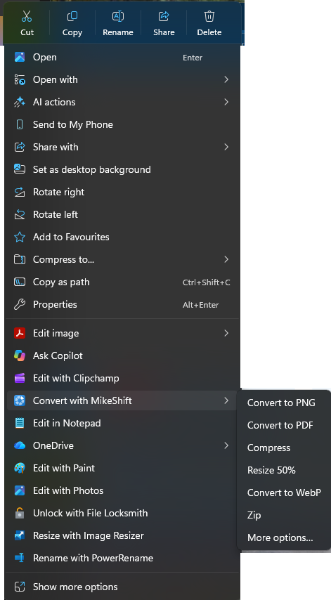
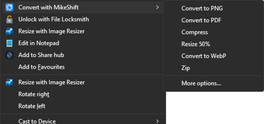
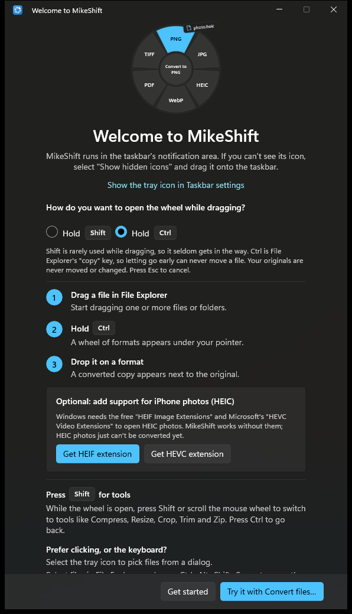
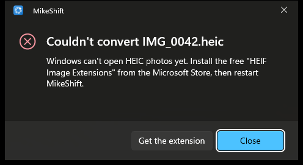

# MikeShift

Right-click files in File Explorer and choose **Convert with MikeShift**, or start dragging a file, hold **Shift** (or **Ctrl**, your choice on first run), and a wheel of output formats appears under the cursor. Drop the file on a tile and a converted **copy** appears next to the original. Press the other key (**Ctrl** by default) while the wheel is up to switch it to tools (compress, resize, crop, trim, split, merge, zip). Prefer the keyboard? Select files in File Explorer and press **Ctrl+Alt+Shift+Space**.

MikeShift is a Windows port of [Shiftvert](https://github.com/roiegold/shiftvert) by roiegold (MIT), for Windows 10 (1809+) and Windows 11. It has no network code, no bundled third-party programs, and it never touches your original files.

| Formats page | Tools page | Light theme |
|:-:|:-:|:-:|
|  |  |  |

| Convert Files… (click mode) | Virtual file | Crop | Trim |
|:-:|:-:|:-:|:-:|
|  |  |  |  |

| Tray menu | Toast | Failure dialog | Settings |
|:-:|:-:|:-:|:-:|
|  |  |  |  |

| Right-click a photo | Right-click three images | Folder | "Show more options" |
|:-:|:-:|:-:|:-:|
|  |  |  |  |

| Welcome: choose Shift or Ctrl, optional HEIC card | Settings: ways to open the wheel | HEIC without the extension | Failure dialog |
|:-:|:-:|:-:|:-:|
|  |  |  |  |

> **Status.** Feature complete against [docs/PLAN.md](docs/PLAN.md); not yet run on real multi-monitor / touch / ARM64 hardware, and not signed for public distribution. [docs/TESTPLAN.md](docs/TESTPLAN.md) says exactly what has and has not been exercised.

| Area | State |
|---|---|
| Core: action catalog, file classification, output naming, Zip, CLI | built |
| Image conversions (PNG, JPG, TIFF, GIF, BMP, HEIC*, WebP, PDF; Compress, Resize 50%, Strip EXIF, Crop, Merge PDF) | built |
| PDF conversions (pages to PNG/JPG, TXT, Compress, Split, Merge) | built |
| Video conversions (MP4, M4V, WMV, GIF, extract M4A/MP3; Compress, Trim) and audio conversions (M4A, WAV, AIFF, FLAC*, MP3*; Compress, Trim) through Media Foundation | built |
| Document conversions (PDF, DOCX, RTF, TXT, HTML, ODT; legacy `.doc` and Word-exported PDFs only if you turn on Microsoft Word) | built |
| Tray app: Fluent flyout menu, Convert files…, toast with Show in folder, failure dialogs, settings cards, welcome window, Open at login, single instance | built |
| Input monitor (low-level hooks), drag state machine, modifier tracking, wheel geometry | built (unit-tested) |
| The wheel: layered Win32 window drawn with Win2D, OLE drop target, Explorer drag-image text ("Convert to PNG"), click mode, UI Automation, light/dark/high-contrast themes | built; driven end to end by `tools/DragHarness` |
| Explorer right-click entry "Convert with MikeShift" (top-level in the Windows 11 menu, one submenu level, "More options…" opens the wheel; out-of-process COM server) | built; driven end to end through the real File Explorer by `tools/ContextMenuHarness` (not run on Windows 10) |
| Crop editor and Trim dialog | built |
| Packaging: IL-trimmed MSIX x64 + ARM64 (self-contained 45 MB, or 23 MB on the shared Windows App Runtime), per-PC downloads plus a bundle, bundled CLI, dev certificate, release script, CI | built (not installed on ARM64 hardware) |

`*` depends on optional Windows codec packages; see [docs/LIMITS.md](docs/LIMITS.md).

## Using it

* **Right-click** (Windows 11 and 10, nothing to learn): select one or more files or folders in File Explorer, right-click, choose **Convert with MikeShift** and pick a line of its submenu. For a HEIC photo that is, for instance, *Convert to JPG*, *Convert to PNG*, *Convert to PDF*, *Compress*, *Resize 50%*, *Zip*; three images also offer *Merge PDF*; a folder, a mixed selection or unknown files offer *Zip*. The last line, **More options…**, opens the wheel of Convert files… (click mode, the same selection) for everything else: the other formats, Crop, Trim, Strip EXIF. A choice runs exactly like a drop on the wheel: a converted copy appears next to the original, the toast says so, the original is never touched. The entry is in Windows 11's top-level menu (no "Show more options" needed; on the Windows 11 build tested it is listed in the classic menu too), and it lives in its own small process, never inside Explorer. If MikeShift is not running, the first click starts it. Limits (Windows 10 not yet tested, the classic menu on other Windows 11 builds, the first click after a quiet spell, Explorer showing only 16 items of a big selection): [docs/LIMITS.md](docs/LIMITS.md).
* **Shift-drag**: begin dragging one or more files or folders in Explorer or on the Desktop, then hold Shift. Drop on a tile to convert. Release anywhere else (or press Esc) and Explorer's own drop proceeds as usual. MikeShift never cancels or changes the drag, and it always asks for a *copy*, so Shift-drag does not move your files.
* **Which key opens the wheel** is your choice, asked on first run and changeable in Settings (*Open the wheel*): **Shift** (the default; Shift-drag is rare in daily use) or **Ctrl** (Explorer's own "copy" key, so letting go early can never move a file). Your originals are never moved or changed, and Esc cancels, in both modes.
* The *other* key switches the wheel between *formats* and *tools* (**Ctrl** in Shift mode, **Shift** in Ctrl mode); the opening key switches back. A mouse-wheel tick toggles too. (Alt is not the default because Left Alt+Shift is Windows' input-language hotkey; it can be chosen in Settings.)
* **Keyboard, touch and pen: the Explorer hotkey.** Select files in a File Explorer window (or on the Desktop) and press **Ctrl+Alt+Shift+Space**: the click-mode wheel opens next to your pointer with exactly those files (arrow keys and Enter). With nothing selected, a toast says "Select files in File Explorer first". Change or turn off the shortcut in Settings (*Convert the files selected in File Explorer*). The default avoids the shortcuts apps already use; Windows tells MikeShift when another program owns the one you pick, and Settings says so.
* **HEIC (iPhone) photos on a PC without Windows' free HEIF extension** are no longer a dead end: the wheel offers **Get HEIF** (and **Get HEVC**, **Get AV1** for AVIF), which opens that extension's Microsoft Store page, and says why. The welcome window offers the same extensions up front, and the command line prints the same advice (`error: Windows can't open HEIC photos yet. Install the free "HEIF Image Extensions"…`).
* **Convert files…** (click the tray icon, or the tray menu): pick files in a dialog; the same wheel opens in the middle of the screen in *click mode* (arrow keys and Enter, or click a tile; Tab switches pages; Esc or clicking elsewhere closes it). Folders cannot be picked there (a Windows dialog limitation); drag them instead.
* Several files of the same kind get that kind's tiles; a mixed selection or unknown files get **Zip** only. A drag from something that is not a real file on disk (an Outlook attachment, a file inside a `.zip`, a browser image) shows "Save the file first".
* **Crop** (images) and **Trim** (video, audio) open a small editor window: aspect presets, scale slider and pixel boxes for Crop; a range slider with start/end boxes for Trim. Enter confirms, Esc cancels.
* Outputs go next to the original: `photo.heic` becomes `photo.png` (`photo 2.png` if that exists). If that folder is not writable they go to Downloads and the toast says so.
* **Tray icon**: left click opens Convert files…; right click opens the menu (Convert files…, Open at login, Settings, How it works, Check for updates, Exit; "Check for updates" opens the releases page in your browser, the app itself never goes online). **Settings**: open at login, a sound and a message when a file is converted (the sound is off by default), show the result in its folder, **use Microsoft Word for Word documents (off by default)**, the key that opens the wheel, the Explorer hotkey, the tools key, which formats this PC supports (with links to the free Microsoft Store extensions), and About.

## Command line

The MSIX puts `mikeshift.exe` on your PATH (an app execution alias, available in new terminals after install). It is the same engine as the wheel and is what the automated tests drive.

```powershell
mikeshift --list photo.heic                    # e.g. PNG, JPG, TIFF, GIF, BMP, WebP, PDF, Compress, Resize 50%, Crop, Strip EXIF, Zip (depends on codecs installed)
mikeshift --run PNG photo.heic                 # prints the output path, exit code 0
mikeshift --run "Resize 50%" a.jpg b.jpg
mikeshift --run Merge a.pdf b.pdf              # Merged.pdf next to a.pdf
mikeshift --run Trim --range 0:05-0:12.5 clip.mp4
mikeshift --run Crop --crop 100,50,800,600@400x300 photo.jpg
mikeshift --run Zip "My Folder"
mikeshift --use-word --run PDF old.doc          # legacy .doc needs Word, and Word is opt-in per run (see Privacy)
```

Errors go to stderr as `error: …` with exit code 1; an unknown action title lists the available ones; any other flag prints usage and exits 2. `--use-word` lets that one run use Microsoft Word (if installed) for legacy `.doc` files and for DOCX to PDF; without it the command line never starts Word. Without installing: `dotnet run --project src/MikeShift.Cli -- --list file.png`.

## Install (sideload)

The MSIX is signed with a certificate you create yourself; Windows only installs packages whose signer it trusts.

```powershell
# 1. Create a self-signed code-signing certificate (subject must match the manifest: CN=MikeShift Dev).
#    Writes artifacts\dev-cert\MikeShiftDev.pfx (private, git-ignored) and MikeShiftDev.cer.
./packaging/make-dev-cert.ps1 -Password (Read-Host -AsSecureString 'PFX password')

# 2. Trust it once, in an ELEVATED PowerShell (the script prints this line for you; it never does it itself).
Import-Certificate -FilePath .\artifacts\dev-cert\MikeShiftDev.cer -CertStoreLocation Cert:\LocalMachine\TrustedPeople

# 3. Build x64 + ARM64, sign, write the per-PC packages, the bundle and the checksums.
./scripts/release.ps1 -PfxPath .\artifacts\dev-cert\MikeShiftDev.pfx -PfxPassword (Read-Host -AsSecureString 'PFX password')

# 4. Install the file for your PC: _x64 for most PCs, _arm64 for Snapdragon / ARM PCs.
#    (The .msixbundle holds both and Windows picks the right one, but it is twice the download.)
Add-AppxPackage -Path .\artifacts\MikeShift_0.1.0.0_x64.msix
```

Uninstall: `Get-AppxPackage MikeShift | Remove-AppxPackage`. Verify a download: compare `Get-FileHash <file> -Algorithm SHA256` with that file's line in `artifacts\SHA256SUMS.txt`.

**Download the file for your PC**: `MikeShift_<version>_x64.msix` (about 45 MB) for most PCs, `MikeShift_<version>_arm64.msix` (about 44 MB) for Snapdragon / ARM PCs. Each is a complete app for one architecture, about 112 MB once installed. The combined `.msixbundle` is about 88 MB for both architectures. The packages are IL-trimmed and carry the .NET 10 runtime and the Windows App SDK, and the command-line tool runs on that same runtime, so **nothing else needs installing**. Release signing for public distribution (Store, Azure Trusted Signing or a purchased certificate) is a separate decision that is not made yet.

### The smaller "store" package (shared Windows App Runtime)

`./scripts/release.ps1 -Flavor store` (or `-Flavor all`) also builds `MikeShift_<version>_store_x64.msix`, `_store_arm64.msix` and `MikeShift_<version>_store.msixbundle`: about **23 MB** per architecture (about 57 MB installed). They depend on the shared **Windows App Runtime 2.5** framework package (`Microsoft.WindowsAppRuntime.2`) instead of carrying WinUI themselves.

* **Microsoft Store**: the Store installs that framework automatically. This is the flavour to submit.
* **Sideloaded**: the framework must be on the PC first, otherwise Windows refuses the install and names the missing package. Install it once with Microsoft's installer for your PC type ([x64](https://aka.ms/windowsappsdk/2.5/2.5.1/windowsappruntimeinstall-x64.exe), [arm64](https://aka.ms/windowsappsdk/2.5/2.5.1/windowsappruntimeinstall-arm64.exe); all downloads: [Windows App SDK downloads](https://learn.microsoft.com/windows/apps/windows-app-sdk/downloads)), or pass the framework package with the install: `Add-AppxPackage -Path MikeShift_0.1.0.0_store_x64.msix -DependencyPath <path to Microsoft.WindowsAppRuntime.2.msix>` (the build leaves Microsoft's copies in `src\MikeShift.App\AppPackages\store\...\Dependencies\<arch>\`). Many PCs already have it because other apps need it.
* For anyone who just wants it to install, hand out the default (non-store) files above.

## Build from source

Needs the .NET 10 SDK and the Windows 10/11 SDK 10.0.26100 (Visual Studio is not required).

```powershell
./scripts/build.ps1 -Test                      # dotnet build MikeShift.sln + dotnet test MikeShift.sln
./scripts/build.ps1 -Configuration Release -Msix -Platforms x64,ARM64   # unsigned per-architecture .msix
./scripts/release.ps1                          # unsigned artifacts\MikeShift_<version>_x64.msix, _arm64.msix, .msixbundle + SHA256SUMS.txt
./scripts/release.ps1 -Flavor all              # the same plus the smaller _store_ packages (shared Windows App Runtime)
./scripts/make-fixtures.ps1                    # sample files for manual testing -> .\fixtures
```

or directly: `dotnet build MikeShift.sln`, `dotnet test MikeShift.sln`. CI (GitHub Actions, `windows-latest`) runs build + test and uploads the unsigned packages of both flavours. Package builds are IL-trimmed (`Trimming.props`; `-p:MikeShiftTrim=false` gives an untrimmed one for comparison). To run the CLI test suites against the trimmed command-line tool of a package, unpack the `.msix` (`makeappx unpack /p <msix> /d <dir> /nv`) and set `MIKESHIFT_CLI_EXE=<dir>\MikeShift.Cli.exe` before `dotnet test tests/MikeShift.Cli.Tests`. `tools/DragHarness` drives scripted Shift-drags against a running build (see [docs/TESTPLAN.md](docs/TESTPLAN.md)). The Windows App SDK is referenced by component (`Directory.Packages.props`), not through the `Microsoft.WindowsAppSDK` metapackage; see [docs/ARCHITECTURE.md](docs/ARCHITECTURE.md) §7.

## Privacy

* No network access anywhere in the product. No telemetry, no update check inside the app.
  Measured, not just claimed: `scripts/verify-offline.ps1` runs every conversion through the real command line and a `MikeShift.exe` session while polling every 50 ms for sockets owned by MikeShift (none were ever seen); `scripts/audit-network-imports.ps1` lists the networking APIs a build can reach ([docs/test-runs/2026-10-24-local-and-integrity.md](docs/test-runs/2026-10-24-local-and-integrity.md)). **MikeShift is fully local by default.** The one optional exception is Microsoft Word: **Settings -> "Use Microsoft Word for Word documents" (off by default; `--use-word` on the command line, per run)** hands legacy `.doc` files and DOCX to PDF to Word, a separate Microsoft program that opens its own connections to Microsoft services (licensing, "connected experiences" and similar, governed by your Office privacy settings; it opened 234 connections to Microsoft in the measurement below). With it off, Word is never started even if it is installed: DOCX to PDF uses MikeShift's own converter and `.doc` files can only be zipped ("Turn on Microsoft Word in Settings to convert .doc files"). For any other format, nothing leaves the PC. Reading an OneDrive "online only" file makes OneDrive download it; that is OneDrive, not MikeShift.
* Originals are never modified or moved: every conversion writes a new file (via a temporary file in the same folder, then a rename, so a failure never leaves a half-written output).
* The right-click entry sees what Explorer shows every context-menu extension: the paths of the selected items. It does not open them to build the menu, hands the request to the tray app over a local named pipe that only your Windows user can open, and keeps its own small log (`shell-log.txt` next to `log.txt`: a line per menu with item counts and errors, no file names).
* The input hook sees only mouse movement, the left button, the wheel and the Shift/Ctrl/Alt/Esc keys, and only to run the gesture. No other key is read or stored. The Explorer hotkey is a Windows `RegisterHotKey` shortcut: Windows tells MikeShift when exactly that shortcut is pressed and nothing else. When you press it, MikeShift asks File Explorer which files are selected (only then).
* While the wheel is up, a small screenshot of the pixels under it is blurred to make the glass effect; it stays in memory and is discarded when the wheel hides.
* Settings (sound, message, tools key, show in folder) are stored locally in the app's settings; Open at login is Windows' own startup-task switch. A small diagnostic log (`log.txt`; Settings, About, "Open the log folder" opens it, which for the installed app is `%LOCALAPPDATA%\Packages\<MikeShift package>\LocalCache\Local\MikeShift`) records start-up and errors (never file contents) and is cut to its newest half when it passes 1 MB.

## More

* [docs/ARCHITECTURE.md](docs/ARCHITECTURE.md) projects, threading, how drag detection and the wheel work, memory behaviour, Microsoft API references
* [docs/LIMITS.md](docs/LIMITS.md) everything that works differently on Windows
* [docs/TESTPLAN.md](docs/TESTPLAN.md) automated tests, the drag harness and the manual checklist
* [assets/brand/mikeshift.svg](assets/brand/mikeshift.svg) the icon source (`scripts/make-icons.ps1` renders every icon; preview: [docs/screenshots/brand/icon-sheet.png](docs/screenshots/brand/icon-sheet.png))
* [docs/PLAN.md](docs/PLAN.md) the original specification; [docs/WORKPLAN.md](docs/WORKPLAN.md) who built what
* [LICENSE](LICENSE) (MIT) and [NOTICE](NOTICE) (credit to the original Shiftvert project and every third-party licence)
