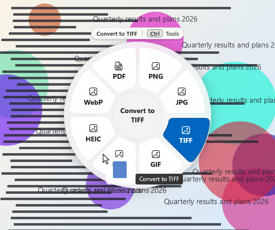

# MikeShift

**Convert any file from File Explorer. Nothing leaves your PC.**

MikeShift turns iPhone photos into JPGs, WebP images into PNGs and loose PDFs into one PDF, and it turns video into MP4, GIF or MP3, without a website, an upload or a separate converter app. Right-click a file in File Explorer, pick a format, and a converted **copy** appears next to the original. The original is never changed.

It is a free, open-source tray app for Windows 10 (version 1809 and later) and Windows 11, with no network code and no account.

| Right-click in File Explorer | Or drag a file and hold Shift (or Ctrl) |
|:-:|:-:|
|  |  |

> **Status: version 1.0 is in preparation and there is no signed release yet.** Everything described here is built and was tested on one Windows 11 x64 PC. It has not yet been run on ARM64 hardware, on Windows 10, or with a screen reader. [Installing today](#install) means building the package and signing it yourself, and [what has not been tested](docs/limitations.md#what-has-and-has-not-been-tested) is written out.

## What people use it for

| I want to… | Do this |
|---|---|
| Turn an iPhone **HEIC** photo into a JPG or PNG | Right-click, **Convert with MikeShift**, **Convert to JPG**. (Needs Microsoft's two free codec extensions; see [HEIC photos](#heic-photos).) |
| Turn a **WebP** (or any web image) into a PNG or JPG | The same. Select many files and they all convert at once. |
| **Merge** images or PDFs into one PDF, **split** a PDF, get a PDF's pages as images or its text | Select two or more files, right-click, **Merge PDF**. Split, page images and text are in the wheel. |
| Make a video an **MP4**, a short **GIF**, or pull out the **MP3** | Right-click, or drag the video onto a format in the wheel. |
| **Shrink** photos to email them | **Compress** or **Resize 50%**. Crop and Strip EXIF are there too. |
| Convert a document (DOCX, RTF, ODT, HTML, TXT) or **zip** files and folders | Right-click, pick the format or **Zip**. |

Everything runs on your PC. **Nothing is uploaded**, there is no telemetry, and you can unplug the network cable and it works the same.

## Three ways in

**1. Right-click (start here).** Select one or more files or folders in File Explorer, right-click, and choose **Convert with MikeShift**. The submenu lists the five most likely conversions for what you selected, then **Zip**, then **More options…**, which opens the full wheel. It is in Windows 11's main right-click menu; no "Show more options" needed.

 

**2. The wheel.** Start dragging a file, then hold **Shift** (or **Ctrl**; you choose on first run). A wheel of output formats appears under the pointer. Drop the file on a tile. Press the other key to switch the wheel to tools: Compress, Resize, Crop, Trim, Zip. Letting go anywhere else, or pressing Esc, cancels.

  

**3. Keyboard and command line.** Select files in File Explorer and press **Ctrl+Alt+Shift+Space** to open the wheel for them (arrow keys and Enter; the shortcut can be changed in Settings). The tray icon's **Convert files…** is a file picker for everything else, and the `mikeshift` command in a terminal is for scripts ([below](#command-line)).


## Why MikeShift

* **Local and private.** The package declares no internet capability and the code has no networking calls. It was also measured: while every action ran on every kind of file, no MikeShift process opened a connection ([how to check it yourself](docs/developer/testing.md#offline-verification)). The one exception is yours to choose: Microsoft Word, if you turn it on in Settings (off by default), is a separate program that talks to Microsoft on its own.
* **Originals are never touched.** Every conversion writes a new file next to the original (`photo.heic` becomes `photo.png`, or `photo 2.png` if that exists) through a temporary file, so a failure leaves no half-written output. The automated tests compare each original's checksum before and after.
* **Small and quiet.** The Microsoft Store package is about 23 MB to download and the sideload package about 45 MB, with no bundled third-party programs. Idle, the tray app uses about 17 MB of memory and no CPU, and the wheel appears within about 30 ms of the key press.
* **Looks like Windows.** WinUI 3 with Mica, light, dark and high-contrast themes, per-monitor scaling, and a wheel that moves away from the taskbar. The wheel has named UI Automation tiles and a keyboard path; it has **not** yet been checked with Narrator, and the drag gesture itself needs a mouse.

## Install

Which file you need depends on your PC and on where you get MikeShift.

| Package | Size | When to use it |
|---|---:|---|
| **Microsoft Store** | about 23 MB | Planned. It will install with no certificate steps and fetch the Windows App Runtime itself. A link will be here once it is published. |
| `MikeShift_<version>_x64.msix` or `_arm64.msix` | about 45 MB | **Sideload**, complete: nothing else to install. **x64** suits most PCs; **ARM64** is for Snapdragon and other ARM PCs (built, but not yet run on ARM hardware). |
| `MikeShift_<version>_store_x64.msix` or `_arm64.msix` | about 23 MB | Sideload, smaller: needs the [Windows App Runtime 2.5](https://learn.microsoft.com/windows/apps/windows-app-sdk/downloads) installed first. |
| `MikeShift_<version>.msixbundle` | about 88 MB | Both architectures in one file (Windows picks the right one); twice the download. |

To find out which you have, open Settings → System → About and read **System type**: "x64-based processor" means x64, "ARM-based processor" means ARM64.

**There is no signed release yet.** Windows installs a package only if it trusts whoever signed it, and public signing (the Store, or a purchased or Azure Trusted Signing certificate) is not set up. Until it is, you build the package and sign it with a certificate you make yourself. This takes a few minutes, needs administrator rights once to trust that certificate, and changes your PC's certificate store, so do it only for software you built or reviewed. You need the build tools listed under [Build from source](#build-from-source).

```powershell
./packaging/make-dev-cert.ps1 -Password (Read-Host -AsSecureString 'PFX password')   # makes a self-signed certificate matching the manifest Publisher
Import-Certificate -FilePath .\artifacts\dev-cert\MikeShiftDev.cer -CertStoreLocation Cert:\LocalMachine\TrustedPeople   # ELEVATED PowerShell, once
./scripts/release.ps1 -PfxPath .\artifacts\dev-cert\MikeShiftDev.pfx -PfxPassword (Read-Host -AsSecureString 'PFX password')
Add-AppxPackage -Path .\artifacts\MikeShift_<version>_x64.msix                       # _arm64 on ARM PCs
```

To verify a file, compare `Get-FileHash <file> -Algorithm SHA256` with its line in `artifacts\SHA256SUMS.txt`. To uninstall, see [the user guide](docs/user-guide.md#uninstalling); it also shows how to remove the trust again.

### HEIC photos

iPhone photos (HEIC) can only be read on Windows with Microsoft's free **HEIF Image Extensions** and **HEVC Video Extensions from Device Manufacturer**, both from the Microsoft Store. Without them MikeShift cannot open a HEIC file and says so: the wheel shows a **Get HEIF** tile that opens the Store page, and the welcome window and the error dialog offer the same. Install them, restart MikeShift, and HEIC works.

## Quick start

1. Start MikeShift. A **Welcome** window opens and an icon appears in the notification area (Windows 11 may keep it in the overflow until you drag it onto the taskbar). Choose **Hold Shift** or **Hold Ctrl** for the wheel; Shift is fine.
2. In File Explorer, right-click a picture and choose **Convert with MikeShift → Convert to PNG**.
3. A message says **Saved photo.png** with a **Show in folder** button. The original is untouched.
4. Now try the wheel: drag the picture a little and hold Shift.


The full walkthrough is the [user guide](docs/user-guide.md): every action by file type, the tools, Settings, keyboard shortcuts, accessibility, the command line, uninstalling and troubleshooting.

## Supported formats

44 actions in all; the wheel and the right-click menu show only the ones that fit your selection and your PC.

| You have | Convert to | Tools |
|---|---|---|
| **Pictures**: PNG, JPG, HEIC, TIFF, GIF, WebP, BMP, AVIF | PNG, JPG, TIFF, GIF, BMP, WebP, HEIC, PDF, TXT (text in the picture) | Compress, Resize, Crop, Strip EXIF, Merge PDF |
| **PDF** | PNG or JPG (pages), TXT (scans too) | Compress, Split, Merge |
| **Video**: MP4, MOV, MKV, AVI, WMV, WebM and others | MP4, M4V, WMV, GIF, or audio only (M4A, MP3) | Compress, Fit 10 MB, Fit 25 MB, Trim |
| **Audio**: MP3, WAV, M4A, FLAC, AIFF, WMA, AAC | M4A, WAV, AIFF, FLAC, MP3 | Compress, Trim |
| **Documents**: DOCX, RTF, ODT, HTML, TXT, Markdown, DOC (needs Word) | PDF, DOCX, RTF, TXT, HTML, ODT | none |
| **Anything, including folders** | Zip | none |

HEIC, AVIF and WebP reading, MP3, FLAC and H.264 encoding, and some video codecs rely on Windows features or optional Microsoft extensions; MikeShift hides tiles that cannot work. Not offered: MOV and AVIF output, dithered GIFs (GIFs are up to 30 s, 480 px), lossless video trim, searchable PDFs. Text from pictures and scans needs a Windows language with text recognition. Documents become PDF with MikeShift's own plain layout, so they will not match Word's pagination. The full tables are in [supported formats](docs/supported-formats.md).

**Limits worth knowing first:** the Windows 10 right-click entry follows Microsoft's documentation but has not been seen on a Windows 10 PC; elevated (administrator) File Explorer windows are invisible to MikeShift; files that are not real files on disk (browser images, Outlook attachments) need saving first; encrypted PDFs are refused. Everything else is in [known limitations](docs/limitations.md).

## Settings you might want

Open **Settings → Conversions** to change **Picture quality** (50–100, default 90), **Compress strength** (Light, Medium, Strong), **Resize** (25, 50 or 75 percent), **GIF length** (5, 10, 15 or 30 seconds) and **Where converted files go** (next to the original, or a folder you choose). Without touching any of this, MikeShift uses sensible defaults. Settings also has the key that opens the wheel, the keyboard shortcut, sound and message options, Open at login, and the Word switch.

## Command line

The package puts `mikeshift.exe` on your PATH (open a new terminal after installing). It uses the same engine as the wheel.

```powershell
mikeshift --list photo.heic                    # what can be done with this file on this PC
mikeshift --run PNG photo.heic                 # prints the output path, exit code 0
mikeshift --run "Resize 50%" a.jpg b.jpg
mikeshift --run Merge a.pdf b.pdf              # Merged.pdf next to a.pdf
mikeshift --run JPG --quality 75 --out D:\Converted photo.heic
```

Errors go to stderr as `error: …` with exit code 1; bad options print the usage and exit 2. Every option and exit code is in the [command-line reference](docs/user-guide.md#command-line).

## Privacy

No network access, no telemetry, no account, no ads. The app never goes online: **Check for updates** and the GitHub and Store links open your browser or the Store app only when you click them. The right-click entry sees the paths Explorer gives every menu extension, hands them to the tray app over a pipe only your Windows user can open, and keeps a small log of counts and errors without file names. The wheel's mouse hook reads mouse movement, the left button, the scroll wheel and Shift, Ctrl, Alt and Esc, only to run the gesture, and stores nothing. The full statement is the [privacy statement](docs/privacy.md).

## Build from source

You need the .NET 10 SDK and the Windows 10/11 SDK 10.0.26100 (Visual Studio is not required).

```powershell
./scripts/build.ps1 -Test                      # build MikeShift.sln and run the tests
./scripts/release.ps1                          # unsigned artifacts\MikeShift_<version>_x64.msix, _arm64.msix, .msixbundle + SHA256SUMS.txt
./scripts/release.ps1 -Flavor all              # the same plus the smaller _store_ packages
```

Or `dotnet build MikeShift.sln` and `dotnet test MikeShift.sln`. CI runs on `windows-latest` and uploads unsigned packages. [CONTRIBUTING.md](CONTRIBUTING.md) explains the workflow, [architecture](docs/developer/architecture.md) how it is put together, [testing](docs/developer/testing.md) how it is tested, and [releasing](docs/developer/releasing.md) how a release is made.

## More

* [User guide](docs/user-guide.md): how to use everything, with troubleshooting and an FAQ
* [Supported formats](docs/supported-formats.md) and [known limitations](docs/limitations.md)
* [Privacy statement](docs/privacy.md)
* [Changelog](CHANGELOG.md)
* [Documentation index](docs/README.md), [contributing](CONTRIBUTING.md), [security policy](SECURITY.md)

## Credits and licence

[MIT licence](LICENSE). [NOTICE](NOTICE) lists every third-party licence.
