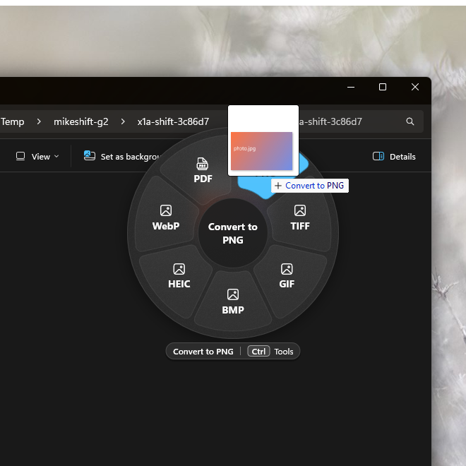
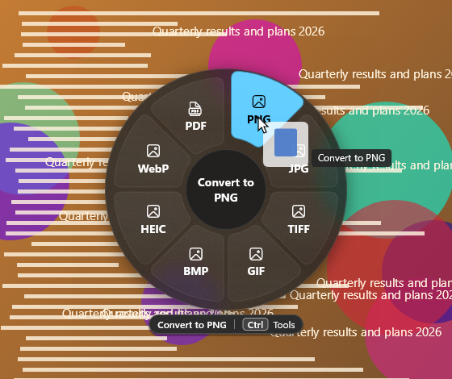
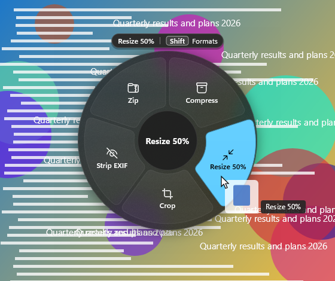
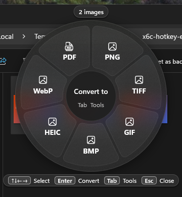

# MikeShift

**Convert any file from File Explorer. Nothing leaves your PC.**

MikeShift turns iPhone photos into JPGs, WebP images into PNGs, and loose PDFs into one PDF, and it turns video into MP4, GIF or MP3, without a website, an upload or a separate converter app. Right-click a file in File Explorer, pick a format, and a converted **copy** appears next to the original. The original is never changed.

It is a free, open-source tray app for Windows 10 (1809 and later) and Windows 11, with no network code and no account. MikeShift is a Windows port of [Shiftvert](https://github.com/roiegold/shiftvert) by roiegold (MIT).

| Right-click in File Explorer | Or drag a file and hold Shift (or Ctrl) |
|:-:|:-:|
|  |  |

> **Status: 0.1, not yet signed or in the Microsoft Store.** All features below are built and were tested on one Windows 11 x64 PC. Not yet run on ARM64 hardware, on Windows 10, or with a screen reader. [How to install it today](#install) and [what the tests did and did not cover](docs/LIMITS.md) are written out; nothing here is rounded up.

## What people use it for

| I want to… | Do this |
|---|---|
| Turn an iPhone **HEIC** photo into a JPG or PNG | Right-click, **Convert with MikeShift**, **Convert to JPG**. (Needs Microsoft's two free codec extensions; see [HEIC](#heic-photos).) |
| Turn a **WebP** (or any web image) into a PNG or JPG | Same. Select many files and they all convert at once. |
| **Merge** images or PDFs into one PDF, **split** a PDF, get a PDF's pages as images or its text | Select two or more files, right-click, **Merge PDF**. Split, page images and text are in the wheel. |
| Make a video an **MP4**, a short **GIF**, or pull out the **MP3** | Right-click, or drag the video onto a format in the wheel. |
| **Shrink** photos to email them | **Compress** or **Resize 50%**. Also Crop and Strip EXIF. |
| Convert a document (DOCX, RTF, ODT, HTML, TXT) or **zip** files and folders | Right-click, pick the format or **Zip**. |

Everything runs on your PC. **Nothing is uploaded**, there is no telemetry, and you can unplug the network cable and it works the same.

## Three ways in

**1. Right-click (start here).** Select one or more files or folders in File Explorer, right-click, and choose **Convert with MikeShift**. The submenu lists the five most likely conversions for what you selected, then **Zip**, then **More options…**, which opens the full wheel. It is in Windows 11's main right-click menu, no "Show more options" needed.

 

**2. The wheel.** Start dragging a file, then hold **Shift** (or **Ctrl**; you choose on first run). A wheel of output formats appears under the pointer. Drop the file on a tile. Press the other key to switch the wheel to tools: Compress, Resize, Crop, Trim, Zip. Letting go anywhere else, or pressing Esc, cancels, and Explorer handles the drop as it normally would. Note that Explorer itself treats a Shift-drop onto a folder as a *move*; if that worries you, choose **Ctrl** (Explorer's copy key) on first run or in Settings.

 

**3. Keyboard and command line.** Select files in File Explorer and press **Ctrl+Alt+Shift+Space** to open the wheel with those files (arrow keys, Enter; changeable in Settings). Or use the `mikeshift` command in a terminal, [below](#command-line). The tray icon's **Convert files…** is a file picker for everything else.



## Why MikeShift

**Local and private, with the evidence.** The package declares no internet capability and the code has no networking calls. Because a desktop app is not sandboxed by that declaration alone, it was also measured: 14,436 samples of the network tables, taken every 50 ms over 19 minutes while every action ran on every kind of file (271 command-line runs plus a tray-app session), found **no TCP connection, listener or UDP endpoint owned by MikeShift**. The method and its limits are in the [test run](docs/test-runs/2026-10-24-local-and-integrity.md). The one exception is yours to choose: Microsoft Word, if you turn it on in Settings (off by default), is a separate program that talks to Microsoft on its own.

**Originals are never touched.** Every conversion writes a new file next to the original (`photo.heic` becomes `photo.png`, or `photo 2.png` if that exists) through a temporary file, so a failure leaves no half-written output. The checks compare the original's SHA-256 before and after. Results: 288 input-by-action checks across all 41 actions, judged by decoders other than MikeShift's own, all passing; 32 scripted drags from a real File Explorer with more than 400 checks, in which no MikeShift conversion changed or moved an original. Six defects found along the way are fixed ([details](docs/test-runs/2026-10-24-local-and-integrity.md)).

**Small, and quiet when idle.** The Microsoft Store package is about 23 MB to download and the sideload package about 45 MB, with no bundled third-party programs. Idle, the tray app used 16.5 MB of memory and 0.00% CPU on the test PC, and the wheel appeared a median 22 ms after Shift (20 warm drags, [measurement](docs/test-runs/2026-10-24-real-drag.md)). For scale, download sizes the [market study](docs/research/positioning.md) recorded on 2026-10-24:

| Tool | Download | What comes with it |
|---|---:|---|
| **MikeShift** (Store / sideload) | **23 / 45 MB** | 41 actions, uses Windows' own codecs where it can |
| File Converter (Tichau) | about 58 MB (MSI) | FFmpeg, ImageMagick, Ghostscript; more formats, custom presets |
| Filee | 128 MB installer, 155 MB portable | 255 formats; some need engines of 100 to 420 MB more |
| ZestDrop | 251 MB portable | about 341 conversions |

Those tools offer more formats and options than MikeShift. If you need one of those formats, use them; MikeShift's job is the common ones, done offline and small.

**Looks like Windows.** WinUI 3 with Mica, light, dark and high-contrast themes, per-monitor scaling, and a wheel that moves away from the taskbar. The wheel has named UI Automation tiles and a keyboard path; it has **not** yet been checked with Narrator, and the drag gesture itself needs a mouse.

## Install

Download the file for your PC. **x64** suits most PCs; **ARM64** is for Snapdragon and other ARM PCs (built, not yet run on ARM hardware).

| Package | Size | When to use it |
|---|---:|---|
| **Microsoft Store** | about 23 MB | Planned. Installs signed with no certificate steps and fetches the Windows App Runtime itself. This will be the recommended route; a link will be here once it is published. |
| `MikeShift_<version>_x64.msix` / `_arm64.msix` | about 45 MB | Sideload. Complete, nothing else to install. |
| `MikeShift_<version>_store_x64.msix` / `_arm64.msix` | about 23 MB | Sideload, smaller, needs the [Windows App Runtime 2.5](https://learn.microsoft.com/windows/apps/windows-app-sdk/downloads) first. |
| `MikeShift_<version>.msixbundle` | about 88 MB | Both architectures in one file; twice the download. |

**There is no signed release yet.** Windows only installs a package whose signer it trusts, and public signing (the Store, or a purchased or Azure Trusted Signing certificate) is not set up. Until it is, you build the package and sign it with a certificate you make yourself. This takes a few minutes, needs administrator rights once to trust that certificate, and changes your PC's certificate store, so only do it for software you built or reviewed:

```powershell
./packaging/make-dev-cert.ps1 -Password (Read-Host -AsSecureString 'PFX password')   # makes the dev certificate (CN=MikeShift Dev)
Import-Certificate -FilePath .\artifacts\dev-cert\MikeShiftDev.cer -CertStoreLocation Cert:\LocalMachine\TrustedPeople   # ELEVATED PowerShell, once
./scripts/release.ps1 -PfxPath .\artifacts\dev-cert\MikeShiftDev.pfx -PfxPassword (Read-Host -AsSecureString 'PFX password')
Add-AppxPackage -Path .\artifacts\MikeShift_0.1.0.0_x64.msix                          # _arm64 on ARM PCs
```

Uninstall with `Get-AppxPackage MikeShift | Remove-AppxPackage`. To verify a file, compare `Get-FileHash <file> -Algorithm SHA256` with its line in `artifacts\SHA256SUMS.txt`. First run shows a short welcome window; Windows 11 may keep the tray icon in the overflow area until you drag it onto the taskbar (the window links to that setting).

### HEIC photos

iPhone photos (HEIC) can only be read on Windows with Microsoft's free **HEIF Image Extensions** and the **HEVC Video Extensions from Device Manufacturer**, both from the Microsoft Store. Without them MikeShift cannot open a HEIC file and says so: the wheel shows a **Get HEIF** tile that opens the Store page, and the welcome window and error dialog offer the same. Install them, restart MikeShift, and HEIC works.

## Supported formats

41 actions in all; the wheel and the right-click menu show only the ones that fit your selection and your PC.

| You have | Convert to | Tools |
|---|---|---|
| **Images**: PNG, JPG, HEIC, TIFF, GIF, WebP, BMP, AVIF | PNG, JPG, TIFF, GIF, BMP, WebP, HEIC, PDF | Compress, Resize 50%, Crop, Strip EXIF, Merge PDF |
| **PDF** | PNG or JPG (pages), TXT | Compress, Split, Merge |
| **Video**: MP4, MOV, MKV, AVI, WMV, WebM and others | MP4, M4V, WMV, GIF, or audio only (M4A, MP3) | Compress, Trim |
| **Audio**: MP3, WAV, M4A, FLAC, AIFF, WMA, AAC | M4A, WAV, AIFF, FLAC, MP3 | Compress, Trim |
| **Documents**: DOCX, RTF, ODT, HTML, TXT, Markdown, DOC (needs Word) | PDF, DOCX, RTF, TXT, HTML, ODT | none |
| **Anything, including folders** | Zip | none |

What depends on your PC: HEIC, WebP reading, AVIF reading, MP3, FLAC and H.264 encoding, and some video codecs rely on Windows features or optional Microsoft extensions, and MikeShift hides tiles that cannot work. Not offered: MOV and AVIF output, dithered GIFs (GIF is capped at 15 s, 480 px), lossless video trim, OCR. Documents become PDF with MikeShift's own plain layout, so they will not match Word's pagination; with Word installed and turned on they can use Word. Details and every refusal message: **[docs/LIMITS.md](docs/LIMITS.md)**.

**Limits worth knowing first:** the Windows 10 right-click entry follows Microsoft's documentation but has not been seen on a Windows 10 PC; elevated (administrator) Explorer windows are invisible to MikeShift; files that are not real files on disk (browser images, Outlook attachments) need saving first; encrypted PDFs are refused.

## Command line

The package puts `mikeshift.exe` on your PATH (open a new terminal after installing). It uses the same engine as the wheel.

```powershell
mikeshift --list photo.heic                    # what can be done with this file on this PC
mikeshift --run PNG photo.heic                 # prints the output path, exit code 0
mikeshift --run "Resize 50%" a.jpg b.jpg
mikeshift --run Merge a.pdf b.pdf              # Merged.pdf next to a.pdf
mikeshift --run Trim --range 0:05-0:12.5 clip.mp4
mikeshift --run Crop --crop 100,50,800,600@400x300 photo.jpg
mikeshift --run Zip "My Folder"
mikeshift --use-word --run PDF old.doc         # legacy .doc needs Word, opt-in per run
```

Errors go to stderr as `error: …` with exit code 1; unknown actions list the available ones; bad flags print usage and exit 2. Without installing: `dotnet run --project src/MikeShift.Cli -- --list file.png`.

## Privacy

No network access, no telemetry, no account, no ads. The app never goes online: **Check for updates** and the GitHub and Store links open your browser or the Store app when you click them. The right-click entry sees the paths Explorer gives every menu extension, hands them to the tray app over a pipe only your Windows user can open, and keeps a small log of counts and errors without file names. The keyboard shortcut is registered with Windows, and MikeShift asks Explorer for the selection only when you press it. The wheel's mouse hook reads mouse movement, the left button, the scroll wheel and Shift, Ctrl, Alt and Esc, only to run the gesture, and stores nothing. The full statement is in [docs/store/privacy-policy.md](docs/store/privacy-policy.md).

## Build from source

Needs the .NET 10 SDK and the Windows 10/11 SDK 10.0.26100 (Visual Studio is not required).

```powershell
./scripts/build.ps1 -Test                      # build MikeShift.sln and run the tests
./scripts/release.ps1                          # unsigned artifacts\MikeShift_<version>_x64.msix, _arm64.msix, .msixbundle + SHA256SUMS.txt
./scripts/release.ps1 -Flavor all              # the same plus the smaller _store_ packages
./scripts/make-fixtures.ps1                    # sample files for manual testing -> .\fixtures
```

Or `dotnet build MikeShift.sln` and `dotnet test MikeShift.sln`. CI runs on `windows-latest` and uploads unsigned packages. `tools/DragHarness` and `tools/ContextMenuHarness` drive scripted drags and right-clicks through a real File Explorer ([docs/TESTPLAN.md](docs/TESTPLAN.md)). Architecture, threading and the API references are in [docs/ARCHITECTURE.md](docs/ARCHITECTURE.md).

## More

* [docs/](docs/README.md): index of the documentation (limits, architecture, test runs, market study, Store listing material)
* [docs/LIMITS.md](docs/LIMITS.md): everything that works differently on Windows or is refused
* [docs/store/](docs/store/listing.md): Microsoft Store listing, privacy policy, screenshots and demo script

## Credits and licence

MikeShift is a Windows port of [Shiftvert](https://github.com/roiegold/shiftvert) by **roiegold** (MIT), the macOS app whose drag-a-file-and-pick-a-format idea it follows. The Windows code, the right-click integration and the packaging are new.

[MIT licence](LICENSE). [NOTICE](NOTICE) lists the credit to Shiftvert and every third-party licence.
