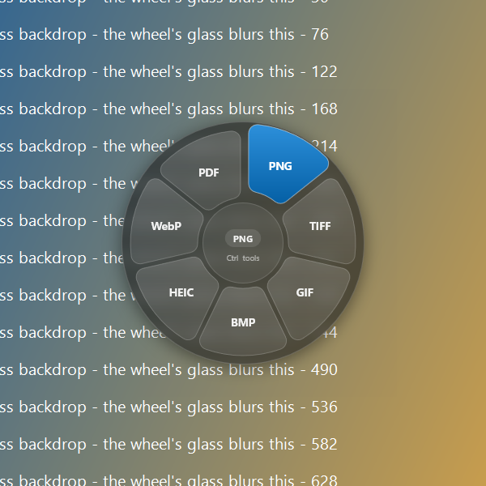
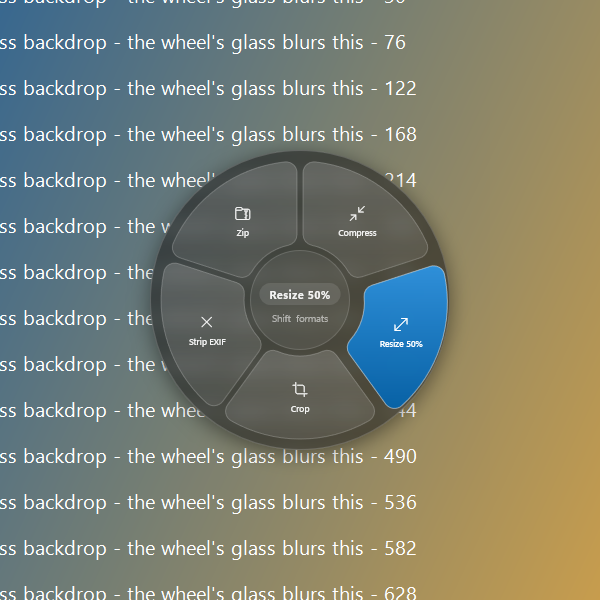
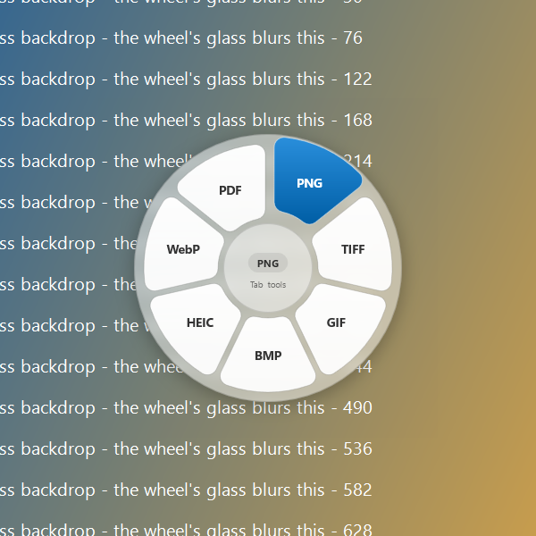
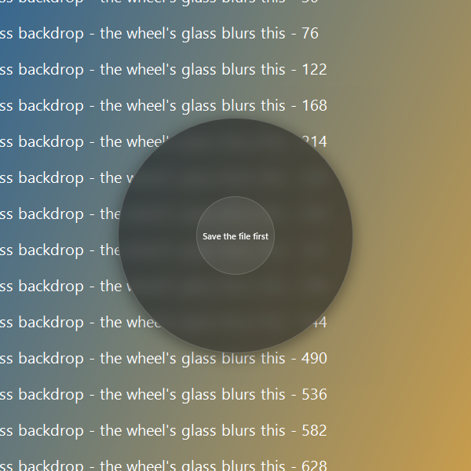
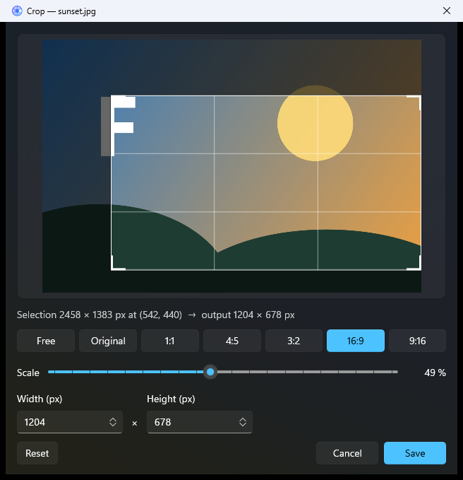
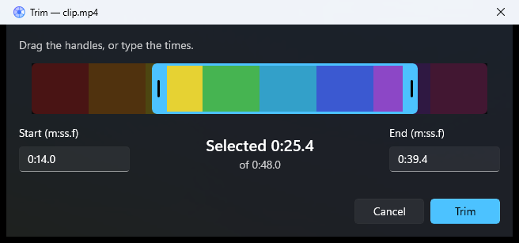
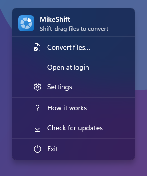
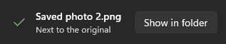
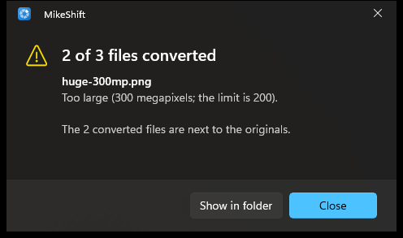
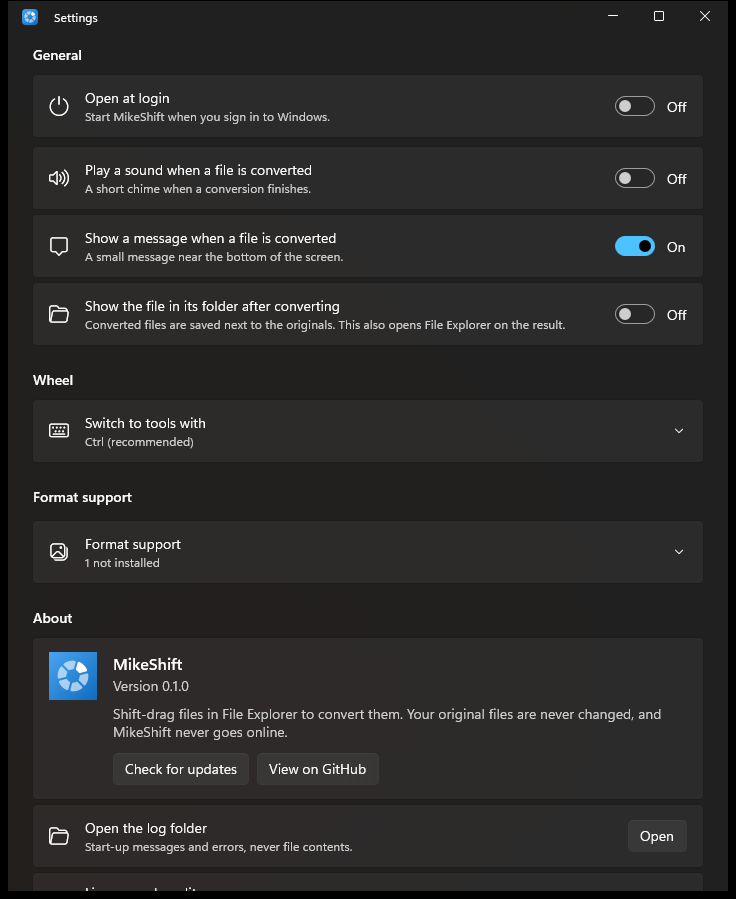

# MikeShift

Start dragging a file in Explorer, hold **Shift**, and a wheel of output formats appears under the cursor. Drop the file on a tile and a converted **copy** appears next to the original. Press **Ctrl** while the wheel is up to switch it to tools (compress, resize, crop, trim, split, merge, zip).

MikeShift is a Windows port of [Shiftvert](https://github.com/roiegold/shiftvert) by roiegold (MIT), for Windows 10 (1809+) and Windows 11. It has no network code, no bundled third-party programs, and it never touches your original files.

| Formats page | Tools page | Light theme |
|:-:|:-:|:-:|
|  |  |  |

| Convert Files… (click mode) | Virtual file | Crop | Trim |
|:-:|:-:|:-:|:-:|
|  |  |  |  |

| Tray menu | Toast | Failure dialog | Settings |
|:-:|:-:|:-:|:-:|
|  |  |  |  |

> **Status.** Feature complete against [docs/PLAN.md](docs/PLAN.md); not yet run on real multi-monitor / touch / ARM64 hardware, and not signed for public distribution. [docs/TESTPLAN.md](docs/TESTPLAN.md) says exactly what has and has not been exercised.

| Area | State |
|---|---|
| Core: action catalog, file classification, output naming, Zip, CLI | built |
| Image conversions (PNG, JPG, TIFF, GIF, BMP, HEIC*, WebP, PDF; Compress, Resize 50%, Strip EXIF, Crop, Merge PDF) | built |
| PDF conversions (pages to PNG/JPG, TXT, Compress, Split, Merge) | built |
| Video conversions (MP4, M4V, WMV, GIF, extract M4A/MP3; Compress, Trim) and audio conversions (M4A, WAV, AIFF, FLAC*, MP3*; Compress, Trim) through Media Foundation | built |
| Document conversions (PDF, DOCX, RTF, TXT, HTML, ODT; legacy `.doc` through Word) | built |
| Tray app: Fluent flyout menu, Convert files…, toast with Show in folder, failure dialogs, settings cards, welcome window, Open at login, single instance | built |
| Input monitor (low-level hooks), drag state machine, modifier tracking, wheel geometry | built (unit-tested) |
| The wheel: layered Win32 window drawn with Win2D, OLE drop target, Explorer drag-image text ("Convert to PNG"), click mode, UI Automation, light/dark/high-contrast themes | built; driven end to end by `tools/DragHarness` |
| Crop editor and Trim dialog | built |
| Packaging: self-contained MSIX x64 + ARM64, bundled CLI, dev certificate, release script, CI | built (not installed on ARM64 hardware) |

`*` depends on optional Windows codec packages; see [docs/LIMITS.md](docs/LIMITS.md).

## Using it

* **Shift-drag**: begin dragging one or more files or folders in Explorer or on the Desktop, then hold Shift. Drop on a tile to convert. Release anywhere else (or press Esc) and Explorer's own drop proceeds as usual. MikeShift never cancels or changes the drag, and it always asks for a *copy*, so Shift-drag does not move your files.
* **Ctrl** while the wheel is up switches between *formats* and *tools*; Shift switches back. A mouse-wheel tick toggles too. (Alt is not the default because Left Alt+Shift is Windows' input-language hotkey; it can be chosen in Settings.)
* **Convert files…** (click the tray icon, or the tray menu): pick files in a dialog; the same wheel opens in the middle of the screen in *click mode* (arrow keys and Enter, or click a tile; Tab switches pages; Esc or clicking elsewhere closes it). Folders cannot be picked there (a Windows dialog limitation); drag them instead.
* Several files of the same kind get that kind's tiles; a mixed selection or unknown files get **Zip** only. A drag from something that is not a real file on disk (an Outlook attachment, a file inside a `.zip`, a browser image) shows "Save the file first".
* **Crop** (images) and **Trim** (video, audio) open a small editor window: aspect presets, scale slider and pixel boxes for Crop; a range slider with start/end boxes for Trim. Enter confirms, Esc cancels.
* Outputs go next to the original: `photo.heic` becomes `photo.png` (`photo 2.png` if that exists). If that folder is not writable they go to Downloads and the toast says so.
* **Tray icon**: left click opens Convert files…; right click opens the menu (Convert files…, Open at login, Settings, How it works, Check for updates, Exit; "Check for updates" opens the releases page in your browser, the app itself never goes online). **Settings**: open at login, a sound and a message when a file is converted (the sound is off by default), show the result in its folder, the tools key, which formats this PC supports (with links to the free Microsoft Store extensions), and About.

## Command line

The MSIX puts `mikeshift.exe` on your PATH (an app execution alias, available in new terminals after install). It is the same engine as the wheel and is what the automated tests drive.

```powershell
mikeshift --list photo.heic                    # e.g. PNG, JPG, TIFF, GIF, BMP, WebP, PDF, Compress, Resize 50%, Crop, Strip EXIF, Zip (depends on codecs installed)
mikeshift --run PNG photo.heic                 # prints the output path, exit code 0
mikeshift --run "Resize 50%" a.jpg b.jpg
mikeshift --run Merge a.pdf b.pdf              # Merged.pdf next to a.pdf
mikeshift --run Trim --range 0:05-0:12.5 clip.mp4
mikeshift --run Crop --crop 100,50,800,600@400x300 photo.jpg
mikeshift --run Zip "My Folder"
```

Errors go to stderr as `error: …` with exit code 1; an unknown action title lists the available ones; any other flag prints usage and exits 2. Without installing: `dotnet run --project src/MikeShift.Cli -- --list file.png`.

## Install (sideload)

The MSIX is signed with a certificate you create yourself; Windows only installs packages whose signer it trusts.

```powershell
# 1. Create a self-signed code-signing certificate (subject must match the manifest: CN=MikeShift Dev).
#    Writes artifacts\dev-cert\MikeShiftDev.pfx (private, git-ignored) and MikeShiftDev.cer.
./packaging/make-dev-cert.ps1 -Password (Read-Host -AsSecureString 'PFX password')

# 2. Trust it once, in an ELEVATED PowerShell (the script prints this line for you; it never does it itself).
Import-Certificate -FilePath .\artifacts\dev-cert\MikeShiftDev.cer -CertStoreLocation Cert:\LocalMachine\TrustedPeople

# 3. Build x64 + ARM64, bundle, sign, write the checksum.
./scripts/release.ps1 -PfxPath .\artifacts\dev-cert\MikeShiftDev.pfx -PfxPassword (Read-Host -AsSecureString 'PFX password')

# 4. Install (Windows picks the right architecture from the bundle).
Add-AppxPackage -Path .\artifacts\MikeShift_0.1.0.0.msixbundle
```

Uninstall: `Get-AppxPackage MikeShift | Remove-AppxPackage`. Verify a download: compare `Get-FileHash <bundle> -Algorithm SHA256` with `artifacts\SHA256SUMS.txt`.

The bundle is about 158 MB for both architectures (about 80 MB per architecture): each architecture carries the .NET 10 runtime and the Windows App SDK components the app uses, and the command-line tool runs on that same runtime, so nothing else needs installing. Release signing for public distribution (Store, Azure Trusted Signing or a purchased certificate) is a separate decision that is not made yet.

## Build from source

Needs the .NET 10 SDK and the Windows 10/11 SDK 10.0.26100 (Visual Studio is not required).

```powershell
./scripts/build.ps1 -Test                      # dotnet build MikeShift.sln + dotnet test MikeShift.sln
./scripts/build.ps1 -Configuration Release -Msix -Platforms x64,ARM64   # unsigned per-architecture .msix
./scripts/release.ps1                          # unsigned artifacts\MikeShift_<version>.msixbundle + SHA256SUMS.txt
./scripts/make-fixtures.ps1                    # sample files for manual testing -> .\fixtures
```

or directly: `dotnet build MikeShift.sln`, `dotnet test MikeShift.sln`. CI (GitHub Actions, `windows-latest`) runs build + test and uploads the unsigned bundle. `tools/DragHarness` drives scripted Shift-drags against a running build (see [docs/TESTPLAN.md](docs/TESTPLAN.md)). The Windows App SDK is referenced by component (`Directory.Packages.props`), not through the `Microsoft.WindowsAppSDK` metapackage; see [docs/ARCHITECTURE.md](docs/ARCHITECTURE.md) §7.

## Privacy

* No network access anywhere in the product. No telemetry, no update check inside the app.
* Originals are never modified or moved: every conversion writes a new file (via a temporary file in the same folder, then a rename, so a failure never leaves a half-written output).
* The input hook sees only mouse movement, the left button, the wheel and the Shift/Ctrl/Alt/Esc keys, and only to run the gesture. No other key is read or stored.
* While the wheel is up, a small screenshot of the pixels under it is blurred to make the glass effect; it stays in memory and is discarded when the wheel hides.
* Settings (sound, message, tools key, show in folder) are stored locally in the app's settings; Open at login is Windows' own startup-task switch. A small diagnostic log (`log.txt`; Settings, About, "Open the log folder" opens it, which for the installed app is `%LOCALAPPDATA%\Packages\<MikeShift package>\LocalCache\Local\MikeShift`) records start-up and errors (never file contents) and is cut to its newest half when it passes 1 MB.

## More

* [docs/ARCHITECTURE.md](docs/ARCHITECTURE.md) projects, threading, how drag detection and the wheel work, memory behaviour, Microsoft API references
* [docs/LIMITS.md](docs/LIMITS.md) everything that works differently on Windows
* [docs/TESTPLAN.md](docs/TESTPLAN.md) automated tests, the drag harness and the manual checklist
* [assets/brand/mikeshift.svg](assets/brand/mikeshift.svg) the icon source (`scripts/make-icons.ps1` renders every icon; preview: [docs/screenshots/brand/icon-sheet.png](docs/screenshots/brand/icon-sheet.png))
* [docs/PLAN.md](docs/PLAN.md) the original specification; [docs/WORKPLAN.md](docs/WORKPLAN.md) who built what
* [LICENSE](LICENSE) (MIT) and [NOTICE](NOTICE) (credit to the original Shiftvert project and every third-party licence)
