# MikeShift user guide

MikeShift converts files from File Explorer. You pick a file, pick what you want it to become, and a converted **copy** appears next to the original. The original is never changed, and nothing is uploaded: everything runs on your PC.

This guide covers everything the app does. If you are in a hurry, read [First run](#first-run) and [Three ways to convert](#three-ways-to-convert), and look at [Troubleshooting](#troubleshooting-and-faq) if something does not appear.

**Contents**

* [First run](#first-run)
* [Three ways to convert](#three-ways-to-convert)
  * [Right-click in File Explorer](#right-click-in-file-explorer)
  * [The wheel](#the-wheel)
  * [The keyboard shortcut](#the-keyboard-shortcut)
  * [Convert files… from the tray](#convert-files-from-the-tray)
* [What you can do with each kind of file](#what-you-can-do-with-each-kind-of-file)
* [Tools](#tools)
* [Where converted files go](#where-converted-files-go)
* [Messages and Show in folder](#messages-and-show-in-folder)
* [Settings](#settings)
* [Keyboard shortcuts](#keyboard-shortcuts)
* [Accessibility](#accessibility)
* [Command line](#command-line)
* [Microsoft Word](#microsoft-word)
* [Uninstalling](#uninstalling)
* [Troubleshooting and FAQ](#troubleshooting-and-faq)

## First run

The first time MikeShift starts, it opens a **Welcome** window and adds an icon to the notification area of the taskbar. You can open the window again any time from the tray icon's menu: **How it works**.

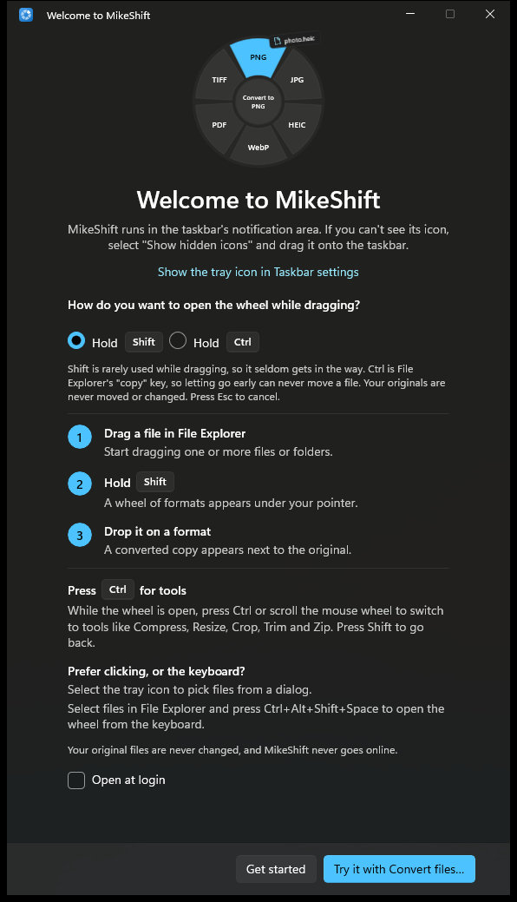

* **Find the tray icon.** Windows 11 may keep new icons in the overflow ("Show hidden icons", the up arrow). Drag the MikeShift icon onto the taskbar if you want it always visible; the window links to the taskbar settings.
* **Choose how to open the wheel while dragging: Hold Shift or Hold Ctrl.** Both work the same way and the other key switches to tools. Shift is the default because Shift is rarely used while dragging. Ctrl is File Explorer's "copy" key, so letting go early can never move a file. If you are unsure, keep Shift; you can change it later in [Settings](#settings).
* **Optional codec extensions.** If your PC cannot open iPhone photos (HEIC) yet, the window shows a card with **Get HEIF extension** and **Get HEVC extension** buttons that open the free Microsoft Store pages. MikeShift works without them; HEIC photos just cannot be converted until you install them and restart MikeShift. See [HEIC photos](#heic-photos-from-an-iphone).
* **Open at login** is a checkbox in the window. It is off by default.
* **Get started** closes the window. **Try it with Convert files…** closes it and opens the file picker so you can convert something right away.

## Three ways to convert

Whichever way you use, the result is the same: a new file next to the original (or in the folder you chose in Settings), and a small message when it is done.

### Right-click in File Explorer

This is the easiest way and the one to start with.

1. In File Explorer, select one or more files or folders.
2. Right-click and choose **Convert with MikeShift**. On Windows 11 it is in the main menu; you do not need **Show more options**.
3. Pick a line from the submenu.

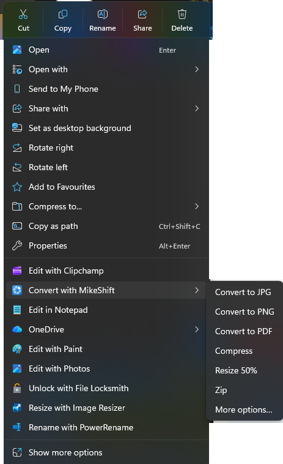

The submenu lists the five most likely actions for what you selected, then **Zip**, then **More options…**. It changes with your selection. Three pictures also offer **Merge PDF**, and a folder offers only **Zip**:

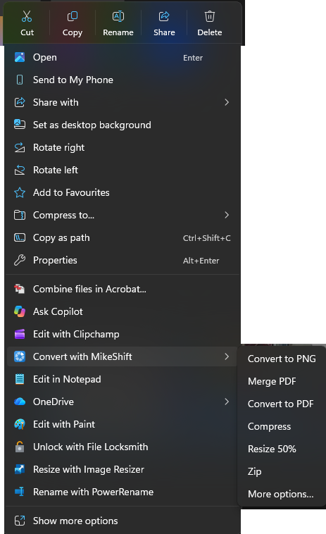 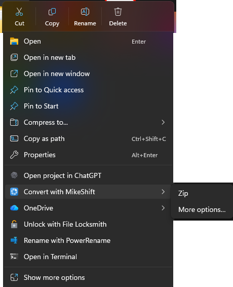

**More options…** opens the full [wheel](#the-wheel) at the pointer, with every format and tool that fits your selection, including Crop and Trim.

Good to know:

* The menu is built from file names, without opening the files, so it appears instantly. When you click a line, MikeShift checks the files for real; if the action does not fit after all, the wheel opens with what is possible instead of showing an error.
* If your PC cannot open HEIC photos, the submenu for a selection of HEIC photos says **Get the free HEIF extension** instead, and picking it opens the Store page.
* On Windows 10, and in the classic Windows 11 menu (**Show more options**, or Shift + right-click), the entry may behave differently. See [the right-click entry](limitations.md#the-right-click-entry) and the [FAQ](#the-right-click-entry-is-missing).

### The wheel

The wheel is a ring of formats that appears under your pointer while you drag.

 

1. In File Explorer (or on the Desktop), start dragging one or more files or folders. Keep the mouse button down.
2. Press and hold **Shift** (or **Ctrl**, if you chose it). The wheel appears under the pointer.
3. Move onto a tile. It lights up, and File Explorer's drag label changes to **Convert to PNG** (or whatever the tile does).
4. Let go over the tile. The converted copy appears next to the original.

While the wheel is open:

* **The other key switches to tools** (Compress, Resize, Crop, Trim, Fit 10 MB, Strip EXIF, Merge, Split, Zip). Press the key you opened the wheel with, once more, to come back to formats. A tick of the mouse wheel switches pages too, and so does Alt if you chose it in Settings.
* **Esc cancels.** Letting go anywhere other than a tile also cancels, and File Explorer then handles the drop the way it normally would. Dropping on the middle of the wheel does nothing.
* The hint line under the wheel shows the keys: for example **Convert to PNG | Ctrl Tools**.
* The wheel stays clear of the taskbar and the edges of your monitors, and it works on any monitor.

Two things to know:

* **The wheel needs a real drag of files.** Dragging text, a window or a rubber-band selection never shows a tile. If you press the key during such a drag, a bare disc may flash for a moment and then goes away.
* **Shift and File Explorer.** In File Explorer a Shift-drop onto an ordinary folder means *move*. MikeShift's wheel always answers *copy*, so your originals stay where they are. If you ever let go on a folder instead of a tile, Explorer's own behaviour applies, and Shift would move the file. If that worries you, choose **Ctrl** (Explorer's copy key) on first run or in Settings.

### The keyboard shortcut

For people who prefer the keyboard, or cannot hold a drag: select files in File Explorer (or on the Desktop) and press **Ctrl+Alt+Shift+Space**. The wheel opens near the pointer for those files.

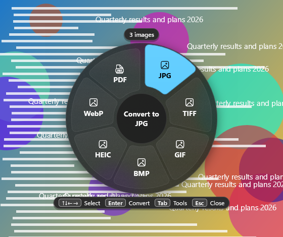

* **Arrow keys** move around the wheel, **Enter** converts, **Tab** switches between formats and tools, **Esc** closes. You can also point and click.
* If nothing is selected, or the front window is not File Explorer or the Desktop, a message says **Select files in File Explorer first**.
* Change the shortcut, or turn it off, in [Settings](#open-the-wheel). If another program already owns the shortcut, Settings says so.

### Convert files… from the tray

Click the MikeShift icon in the notification area (or right-click it and choose **Convert files…**). A file picker opens; pick one or more files and the same wheel opens for them. This works for anything you can reach with a file dialog, including files File Explorer's drag is awkward for. It picks **files**; to convert a folder, use the right-click menu or drag the folder.


The tray menu (right-click the icon) has:

* **Convert files…** (left-clicking the icon does the same).
* **Show last file in folder**, for about a minute after a conversion.
* **Open at login**: start MikeShift when you sign in to Windows.
* **Settings**.
* **How it works**: the Welcome window again.
* **Check for updates**: opens this project's releases page in your browser. MikeShift never goes online by itself.
* **Exit**.

Starting MikeShift a second time does not start a second copy; it pops up the tray menu at the pointer.

## What you can do with each kind of file

The wheel and the right-click menu show only what fits your selection and works on your PC. This table is the full set; the formats and their requirements are in [supported formats](supported-formats.md).

| You select | Formats (convert to) | Tools |
|---|---|---|
| **Pictures** (PNG, JPG, HEIC, TIFF, GIF, WebP, BMP, AVIF …) | PNG, JPG, TIFF, GIF, BMP, WebP, HEIC, ICO, PDF, TXT (the text in the picture) | Compress, Resize, Crop, Strip EXIF, Merge PDF (two or more pictures) |
| **PDF** | PNG or JPG (one image per page), TXT (including scanned pages) | Compress, Split, Merge (two or more PDFs) |
| **Video** (MP4, MOV, MKV, AVI, WMV, WebM …) | MP4, M4V, WMV, GIF, M4A (audio only), MP3 (audio only) | Compress, Fit 10 MB, Fit 25 MB, Trim |
| **Audio** (MP3, WAV, M4A, FLAC, AIFF, WMA …) | M4A, WAV, AIFF, FLAC, MP3 | Compress, Trim |
| **Documents** (DOCX, RTF, ODT, HTML, TXT, Markdown, DOC) | PDF, DOCX, RTF, TXT, HTML, ODT | none |
| **Anything, including folders and mixed selections** | none | Zip |

Select many files of one kind and every one is converted (a batch). A mixed selection, such as a picture and a PDF, offers only **Zip**.

### Icons from pictures

**ICO** on a picture, such as a logo, writes a Windows icon next to it: `logo.png` becomes `logo.ico`, holding 16, 24, 32, 48, 64, 128 and 256 pixel images, which covers the desktop, the taskbar and a website favicon. A picture that is not square is centred on a transparent square instead of being stretched, and transparency is kept. For a sharp result start from a picture at least 256 pixels wide and tall; a smaller one still converts, and the toast says the larger sizes will look soft. Also `mikeshift --run ICO logo.png`. The tile is not shown for a file that is already an `.ico`.

### Text from pictures and scans

**TXT** on a picture, such as a screenshot or a photo of a page, writes the text in it to `photo.txt` next to it. **TXT** on a PDF reads the PDF's text, and reads scanned pages too. Both use Windows' own text recognition (OCR) on your PC; nothing is uploaded. Windows reads the languages you have installed (Settings > Time & language > Language & region; a language's options must include **Optical character recognition**, which most include). On a PC with none, the picture TXT tile is hidden, PDF TXT refuses scans, and Settings → Format support says so. Text recognition reads printed text line by line; it does not read handwriting or rebuild columns and tables.

### HEIC photos from an iPhone

Windows can open HEIC photos only with Microsoft's free **HEIF Image Extensions** and **HEVC Video Extensions from Device Manufacturer** (both from the Microsoft Store). Without them MikeShift cannot open a HEIC file, and says so rather than failing silently:

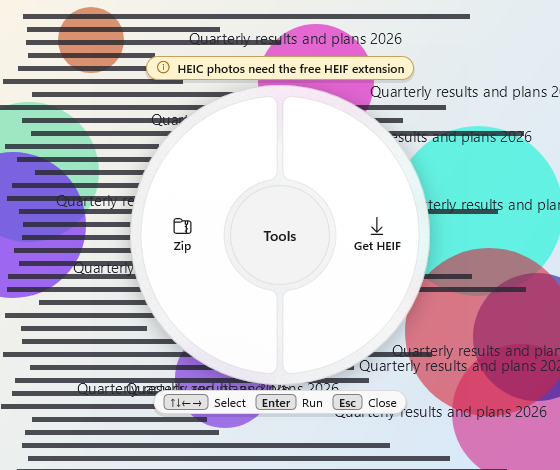 

The wheel shows a **Get HEIF** tile that opens the Store page, the right-click menu has a **Get the free HEIF extension** line, and the failure dialog has a **Get the extension** button. Install the extensions, then **restart MikeShift** (it checks your PC once at start). Settings → Format support shows what is installed.

## Tools

Tools appear on the wheel's second page (and on the right-click menu where they are among the most likely actions). Each one writes a copy; the original stays as it is.

| Tool | For | What it does | Output name |
|---|---|---|---|
| **Compress** | Pictures | Makes a smaller picture in the same format: the long side is limited (3,000 pixels by default, see [Settings](#conversions)) and quality is lowered. It keeps the result only if it saves at least 5 percent, otherwise it says the picture is already small. | `photo compressed.jpg` |
| | PDF | Recompresses the pictures inside. Kept only if smaller. | `report compressed.pdf` |
| | Video | Makes a 720p H.264/AAC MP4. Kept only if smaller. | `clip compressed.mp4` |
| | Audio | Makes a smaller AAC M4A. Kept only if smaller. | `song compressed.m4a` |
| **Resize** | Pictures | Makes a copy at 50 percent of the width and height (or 25 or 75 percent, see [Settings](#conversions)). The tool is then called **Resize 25%**. | `photo 50%.jpg` |
| **Crop** | Pictures | Opens the crop editor; see below. | `photo cropped.jpg` |
| **Strip EXIF** | Pictures | Removes the metadata (camera, location, date) and keeps the picture upright. | `photo clean.jpg` |
| **Fit 10 MB**, **Fit 25 MB** | Video | Makes an MP4 small enough to attach: at most 10 MB (or 25 MB), never over it. A video already under the size is copied into MP4 without re-encoding where possible. A video too long to stay watchable at that size is refused, with roughly how long one can be. See [supported formats](supported-formats.md#video). | `clip 10 MB.mp4` |
| **Trim** | Video, audio | Opens the trim dialog; see below. | `clip trimmed.mp4` |
| **Merge PDF** | Two or more pictures | Puts them into one PDF, in the order listed. | `Merged.pdf` |
| **Merge** | Two or more PDFs | Joins them into one PDF. | `Merged.pdf` |
| **Split** | PDF | One PDF per page, in a new folder. | `report split` (folder) |
| **Zip** | Anything | Puts the files and folders into a zip archive. One item becomes `<name>.zip`; several become `Archive.zip`. | `photo.zip`, `Archive.zip` |

PDF to PNG or JPG also writes a folder (`report pages`) with one image per page.

### Crop and Trim

**Crop** opens a small editor for the picture:

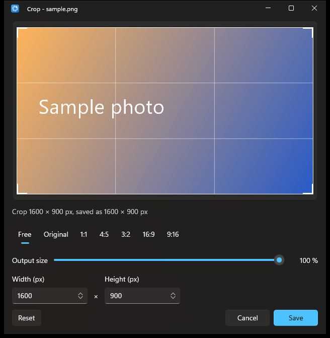

* Drag the box, or its corners and edges. Arrow keys nudge it one pixel, Shift and arrow keys ten.
* Pick a shape (**Free**, **Original**, **1:1**, **4:5**, **3:2**, **16:9**, **9:16**), or type a width and height in pixels. The **Output size** slider saves the crop at a smaller size.
* **Save** (or Enter) writes `photo cropped.jpg`. **Cancel** (or Esc) writes nothing. **Reset** goes back to the whole picture.
* Animated pictures and multi-page files (a multi-page TIFF) cannot be cropped; MikeShift says so before the editor opens.

**Trim** opens a dialog for the video or audio file:

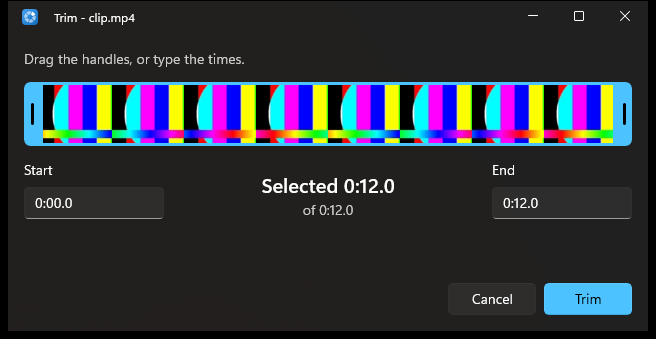

* Drag the two handles, or type the start and end times (`m:ss.f`, for example `0:05` and `0:12.5`).
* **Trim** (or Enter) writes the selected part; **Cancel** (or Esc) writes nothing.
* Video is re-encoded so the cut is exact (as MP4, or WMV for WMV sources). WAV and AIFF audio is cut without any loss; other audio becomes an M4A.

## Where converted files go

* **Next to the original,** by default, with the same name and the new extension: `photo.heic` becomes `photo.png`.
* **Names never overwrite.** If `photo.png` exists, the new file is `photo 2.png`, then `photo 3.png`. The result of a tool adds a word (`photo compressed.jpg`, `photo 50%.jpg`, `photo cropped.jpg`, `photo clean.jpg`, `clip trimmed.mp4`, `clip 10 MB.mp4`).
* **In a folder you choose,** if you set **Where converted files go** in [Settings](#conversions). If that folder is missing or cannot be written to, the files go to your **Downloads** folder for that job and the message says so.
* **If the original's folder cannot be written to** (a read-only share, a protected folder), the files go to **Downloads** too, and the message says "in Downloads".
* **Merged and zipped files** are named `Merged.pdf` and `Archive.zip` (or `<name>.zip` for a single item) and placed next to the first file.
* **Safe by construction.** Each conversion is written to a hidden temporary folder next to the result and moved into place at the end, so a failed or cancelled conversion leaves nothing half-written. The original is never edited, moved or deleted.

## Messages and Show in folder

When a conversion finishes, a small message appears near the bottom of the screen:

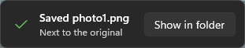 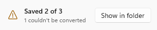

* **Saved photo1.png / Next to the original.** For several files it says **Saved 3 files**. While a conversion is running it says **Converting to PNG…** and, for a batch, **Converting 2 of 5…**. If other conversions are running too, it adds "2 more in progress".
* **Show in folder** opens File Explorer with the new file selected.
* If some files in a batch fail, the message says **Saved 2 of 3 / 1 couldn't be converted**; if the problem needs explaining (a damaged file, a missing codec), a small dialog lists each file and why. If every file fails, the dialog says so.
* The message disappears by itself after a few seconds. You can turn it off in Settings; failures still show a dialog.
* You can also have MikeShift **play a sound** when a conversion finishes, and **open File Explorer on the result** automatically. Both are off by default.

## Settings

Open Settings from the tray menu. The window is organised in cards, like Windows' own Settings. Changes apply immediately.

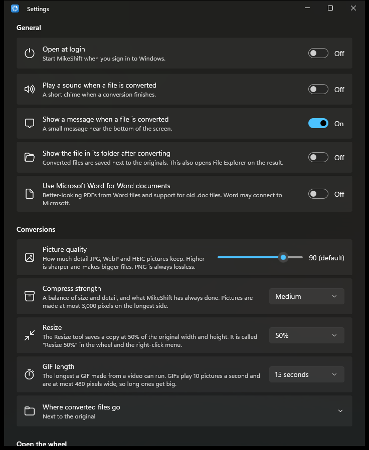

### General

| Card | What it does |
|---|---|
| **Open at login** | Starts MikeShift when you sign in to Windows. This is Windows' own startup switch; it also appears in Windows Settings → Apps → Startup. Off by default. |
| **Play a sound when a file is converted** | A short chime when a conversion finishes. Off by default. |
| **Show a message when a file is converted** | The small message near the bottom of the screen. On by default. |
| **Show the file in its folder after converting** | Also opens File Explorer on the result. Off by default. |
| **Use Microsoft Word for Word documents** | Lets MikeShift use Word for old `.doc` files and for a better-looking PDF from DOCX. Off by default; see [Microsoft Word](#microsoft-word). Greyed out with an explanation if Word is not installed. |

### Conversions

| Card | What it does |
|---|---|
| **Picture quality** | 50 to 100 (default 90). How much detail JPG, WebP and HEIC pictures keep. Higher is sharper and makes bigger files. PNG is always lossless. |
| **Compress strength** | **Light**, **Medium** (default) or **Strong**: how hard the picture Compress tool squeezes (long side 4,000, 3,000 or 2,000 pixels). PDF, video and audio Compress are not affected. |
| **Resize** | **25%**, **50%** (default) or **75%**: how much of the original width and height the Resize tool keeps. The tool is then called **Resize 25%** in the wheel and the right-click menu. |
| **GIF length** | **5**, **10**, **15** (default) or **30 seconds**: the longest a GIF made from a video can run. GIFs play 10 pictures a second and are at most 480 pixels wide, so long ones get big. |
| **Where converted files go** | **Next to the original** (default) or **A folder I choose**, with a **Choose folder…** button. If the folder is not available, the files go to Downloads and Settings shows a warning. |

### Open the wheel

| Card | What it does |
|---|---|
| **Open the wheel while dragging with** | **Hold Shift** (default) or **Hold Ctrl**. See [First run](#first-run) for the trade-off. |
| **Convert the files selected in File Explorer** | Shows the [keyboard shortcut](#the-keyboard-shortcut) (**Ctrl + Alt + Shift + Space**). Select it to press a new shortcut (Esc cancels), or choose **Turn off**. MikeShift warns about shortcuts other programs and Windows use, and tells you when Windows says another program already owns the one you picked. |

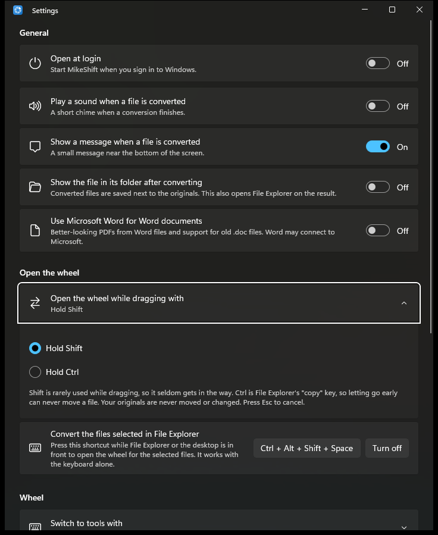

### Wheel

| Card | What it does |
|---|---|
| **Switch to tools with** | The other of Shift and Ctrl (recommended), **Mouse wheel only**, or **Alt**. Alt is available but not the default: Left Alt+Shift is Windows' input-language shortcut. A tick of the mouse wheel always works. |

### Format support

Shows what this PC can do: which Microsoft Store extensions are installed (HEIF, HEVC, AV1, WebP, Web Media) and a **Get from Microsoft Store** link for each missing one, and whether Windows has a language for reading text in pictures and scanned PDFs, with how to add one. If you install an extension while MikeShift is running, a **Restart MikeShift** button appears.

### About

* The version, **Check for updates** and **View on GitHub** (both open your browser).
* **Open the log folder**: opens the folder with MikeShift's log (start-up messages and errors, never file contents). Useful when asking for help.
* **Licence and credits**: MikeShift is open source (MIT); the link opens every third-party licence.

## Keyboard shortcuts

| Where | Keys | What happens |
|---|---|---|
| File Explorer or Desktop | **Ctrl+Alt+Shift+Space** (changeable) | Opens the wheel for the selected files |
| File Explorer | **Menu key** or **Shift+F10** | Opens the right-click menu for the selected files; choose **Convert with MikeShift** |
| While dragging | **Shift** (or **Ctrl**) | Opens the wheel |
| The wheel while dragging | the other key, a mouse-wheel tick | Switch between formats and tools |
| The wheel while dragging | **Esc** | Closes the wheel and cancels the drag |
| The wheel opened from the keyboard, the tray or the right-click menu | **Arrow keys** | Move around the wheel |
| | **Enter** | Convert with the highlighted tile |
| | **Tab** | Switch between formats and tools |
| | **Esc** | Close the wheel (so does clicking another window) |
| Crop editor | **Arrow keys** / **Shift+arrows** | Move the crop box 1 / 10 pixels |
| Crop editor, Trim dialog | **Enter** / **Esc** | Save / cancel |
| Tray menu | the underlined letters (access keys) | **C** Convert files…, **L** Open at login, **S** Settings, **H** How it works, **U** Check for updates, **X** Exit |

## Accessibility

* **Keyboard.** Everything can be done without dragging: the keyboard shortcut opens the wheel for the selected files, the right-click menu opens from the Menu key, and the wheel and the editors work with arrow keys, Tab, Enter and Esc. The drag gesture itself needs a mouse.
* **Screen readers.** The wheel is exposed to UI Automation as a list whose items are named after what they do ("Convert to PNG", "Compress"), with a help text for the keys; Settings cards are named with their current value ("Picture quality, 90"). This has been built for Narrator and other screen readers but **has not yet been checked with one**; please report anything that is not announced.
* **Themes.** MikeShift follows Windows: light, dark and high-contrast themes. In high contrast the wheel uses system colours instead of the glass effect.
* **Motion.** If Windows' **Animation effects** are off, MikeShift does not animate.
* **Text size and scaling.** The wheel follows Windows' text size setting and per-monitor display scaling.

## Command line

The package adds a `mikeshift` command to your PATH (open a new terminal after installing). It uses the same engine as the wheel, without any windows, so it suits scripts.

```powershell
mikeshift --list photo.heic                    # what can be done with this file on this PC
mikeshift --run PNG photo.heic                 # prints the output path, exit code 0
mikeshift --run "Resize 50%" a.jpg b.jpg
mikeshift --run Merge a.pdf b.pdf              # Merged.pdf next to a.pdf
mikeshift --run TXT screenshot.png scan.pdf    # the text in a picture and in a scanned PDF
mikeshift --run Trim --range 0:05-0:12.5 clip.mp4
mikeshift --run "Fit 10 MB" clip.mov            # an MP4 of at most 10 MB
mikeshift --run Crop --crop 100,50,800,600@400x300 photo.jpg
mikeshift --run Zip "My Folder"
mikeshift --use-word --run PDF old.doc         # legacy .doc needs Word, opt-in per run
mikeshift --run JPG --quality 75 --out D:\Converted photo.heic
```

### Synopsis

```text
mikeshift [--use-word] [OPTIONS] --list FILES...
mikeshift [--use-word] [OPTIONS] --run TITLE [--range m:ss-m:ss] [--crop X,Y,W,H[@OWxOH]] FILES...
```

| Option | Meaning |
|---|---|
| `--list` | Prints, on one line separated by commas, the actions that can be run on these files on this PC (exit code 0). |
| `--run TITLE` | Runs one action on all the files and prints the path of each output, one per line. `TITLE` is a name from `--list`, such as `PNG`, `Compress`, `"Resize 50%"`, `"Fit 10 MB"`, `"Strip EXIF"` or `Zip`. `Resize` and `Fit` alone also work. |
| `--use-word` | Lets this run use Microsoft Word, if it is installed (legacy `.doc`, Word's own PDF export). Without it the command line never starts Word. See [Microsoft Word](#microsoft-word). |
| `--range m:ss-m:ss` | For **Trim**: the part to keep, for example `--range 0:05-0:12.5` (`h:mm:ss` and fractions are accepted). |
| `--crop X,Y,W,H[@OWxOH]` | For **Crop**: the rectangle in pixels from the top-left corner, and an optional output size, for example `--crop 100,50,800,600@400x300`. |
| `--quality N` | JPG, WebP and HEIC quality, 50 to 100 (default 90). |
| `--compress LEVEL` | How hard picture Compress squeezes: `light`, `medium` (default) or `strong`. |
| `--resize P` | The Resize percentage: 25, 50 or 75 (default 50). `--run "Resize 25%"` says the same thing. |
| `--gif-seconds N` | The longest a GIF made from a video runs: 5, 10, 15 (default) or 30. |
| `--max-size MB` | The size the video Fit tool keeps under, in whole megabytes from 1 to 2000, for scripts that need another limit than 10 or 25 MB. `--list` then offers that one size (`Fit 8 MB`) instead of the two, and `--run "Fit 8 MB"` says the same thing. |
| `--out DIR` | Put converted files in this existing folder instead of next to the originals (Downloads if it cannot be written to). |
| `--` | Everything after it is a file name, even if it starts with a dash. |

The command line **never reads Settings**, so a script gives the same result on every PC; the options above are the only way to change a run.

### Output and exit codes

* **Standard output** gets the full path of every file written, one per line.
* **Standard error** gets messages: `error: …` for a problem, and `note: …` for things worth knowing ("2 already PNG", "saved in Downloads").
* **Exit code 0**: everything succeeded.
* **Exit code 1**: an error. The message is on standard error: a file that does not exist (`error: not found: …`), an unknown action (the message lists the actions that are available), a file that cannot be converted, a cancelled run, or `Trim` and `Crop` without `--range` or `--crop` (which prints the syntax). In a batch, files that can be converted are converted and each failure is listed; the exit code is 1 if any failed.
* **Exit code 2**: a usage error: an unknown option, a missing argument, a value out of range (`--quality 40`, `--resize 60`, `--gif-seconds 20`, `--compress heavy`, `--max-size 0`), an `--out` folder that does not exist, or `--run "Resize 25%"` together with `--resize 75` (or `--run "Fit 10 MB"` with `--max-size 25`). The usage text is printed.

Without installing the package you can run it from a source checkout: `dotnet run --project src/MikeShift.Cli -- --list file.png`.

## Microsoft Word

MikeShift is fully local, and Word is not: it is a separate Microsoft program that may connect to Microsoft on its own. That is why using it is **off by default**.

Turn on **Settings → Use Microsoft Word for Word documents** (or pass `--use-word` on the command line for one run) if you want:

* **Old `.doc` files** converted. Without Word they offer only Zip.
* **DOCX to PDF** laid out by Word, with its fonts, columns and pagination, instead of MikeShift's own plain layout.

Word then runs invisibly in the background on a private copy of the file and is closed afterwards, which takes a second or two longer than the built-in converters. With the setting off, Word is never started, even if it is installed. Details: [Microsoft Word in the limitations](limitations.md#microsoft-word) and the [privacy statement](privacy.md#third-parties).

## Uninstalling

* **Windows 11:** Settings → Apps → Installed apps → MikeShift → Uninstall.
* **Windows 10:** Settings → Apps → Apps & features → MikeShift → Uninstall.
* **PowerShell:** `Get-AppxPackage *MikeShift | Remove-AppxPackage`.

Uninstalling removes the app, the right-click entry, the `mikeshift` command, MikeShift's settings and its logs. Your files and the converted copies are not touched.

If you installed a package signed with a certificate you made yourself, you can also remove that trust. In an elevated PowerShell:

```powershell
Get-ChildItem Cert:\LocalMachine\TrustedPeople | Where-Object FriendlyName -like 'MikeShift Dev*' | Remove-Item
```

## Troubleshooting and FAQ

### The wheel does not appear

Work through these in order:

1. **Is MikeShift running?** Look for its icon in the notification area, including the hidden-icons overflow. If it is not there, start MikeShift from the Start menu. A second start pops up the tray menu, which also shows it is running.
2. **Are you really dragging files?** The wheel needs the left mouse button held down on a file or folder, moving, and then the key (Shift or Ctrl, as chosen in Settings) pressed *during* the drag. Pressing the key and then clicking is a different gesture (it selects).
3. **Is the other program running as administrator?** Windows stops normal programs from seeing what administrator windows do. A drag from an elevated File Explorer, or from an elevated app, shows no wheel. Use File Explorer without "Run as administrator". MikeShift itself must also not be run as administrator; if it is, it shows a warning.
4. **Is it a file drag?** The wheel appears for real files and folders from File Explorer and the Desktop. It does not appear for text, windows, or items that are not real files on disk. Dragging an attachment out of Outlook, an image out of a browser, a file out of a `.zip` opened in File Explorer, or a file from a phone shows **Save the file first, then drag it**: save the file somewhere, then drag the saved file. Programs that do not use Windows' standard drag and drop (some games, remote-desktop windows) never offer files either.
5. **Which key did you choose?** If you chose Ctrl, Shift will not open the wheel (and the other way round). Check **Settings → Open the wheel**.
6. **Is something else using the key?** Another program that grabs Shift or Ctrl (a remapping tool, a gaming overlay, an accessibility program with sticky keys) can hide it from MikeShift. Try the other key, or the keyboard shortcut or right-click instead.
7. **Look at the log.** Settings → About → **Open the log folder** shows what MikeShift saw. It never contains file contents.

### The keyboard shortcut does nothing

* The shortcut works only when File Explorer (or the Desktop) is the front window and files are selected. Otherwise a message says **Select files in File Explorer first**.
* **Another program may own the shortcut.** Only one program can register a global shortcut. Settings → **Convert the files selected in File Explorer** says when Windows refused it. Select the button and press a different shortcut. The default has three modifiers because shorter ones are used by other apps.
* An elevated (administrator) File Explorer window cannot be read by a normal MikeShift.
* "This PC", the Recycle Bin and phones count as nothing selected, because their items are not files on disk.

### The right-click entry is missing

* **Windows 11:** look in the main menu first. If it is not there, **restart File Explorer** (Task Manager → Windows Explorer → Restart) or sign out and in again: Windows may not show a newly installed or updated entry until then. If you have forced the classic Windows 10-style menu with a registry change, the modern menu (where the entry lives) is not shown at all; use the wheel, the shortcut or the tray's Convert files…
* **"Show more options"** (the classic menu, also Shift + right-click): on the Windows 11 build MikeShift was tried on, the entry is listed there too, with the same submenu, but that is not guaranteed on other builds.

  
* **Windows 10:** the entry is declared for Windows 10 1809 and later but has not been tested there.
* **Nothing is offered for the selection:** there is no entry for items that are not real files on disk (virtual folders, devices, items inside a `.zip` opened in Explorer), and none on the empty background of a folder or on a drive. Select the files themselves.
* **You are running an unpackaged build** (`MikeShift.exe` from a source build, or `dotnet run`). The right-click entry exists only for the installed package.
* **The first right-click after a quiet spell is slower** (about half a second); that is the extension starting up, not a freeze.

### "Save the file first"

The file is not a real file on disk yet: it is an attachment, a browser image, a phone file or an item inside a `.zip` that File Explorer is only showing. Save or extract it to a folder, then drag or right-click that file.

### My HEIC photos do not convert

You need Microsoft's free **HEIF Image Extensions** and **HEVC Video Extensions from Device Manufacturer** from the Microsoft Store (see [HEIC photos](#heic-photos-from-an-iphone)). Install both, then restart MikeShift. If both are installed and a HEIC still does not open, the file may be damaged.

### Other tiles are missing

MikeShift hides what your PC cannot do. Settings → Format support lists the extensions behind WebP, AVIF, HEIC and WebM. MP3, FLAC, MP4 and M4A need Windows' built-in encoders; HEVC, VP9 and AV1 video need their Windows video extensions. A format is also not offered for a file that is already in it, and Merge needs at least two files.

### "This image is already small" / "already small enough"

Compress keeps its result only if it is smaller (at least 5 percent for pictures). Otherwise it tells you the file is already small and writes nothing. Pictures with transparency compress to PNG, so they are often already small.

### Where is the log?

Settings → About → **Open the log folder**. The files are `log.txt` (start-up messages, counts and errors) and `shell-log.txt` (one line per right-click menu). Neither contains file contents. The folder lives under `%LOCALAPPDATA%\Packages\<MikeShift package>\LocalCache\Local\MikeShift`.

### Where did my converted file go?

Next to the original, unless you chose a folder in Settings, or that folder was not writable and the file went to **Downloads**. The message says which, and **Show in folder** opens it. A tray menu item, **Show last file in folder**, does the same for about a minute.

### What does the Word setting mean?

It lets MikeShift hand old `.doc` files and DOCX-to-PDF conversions to Microsoft Word, if you have it. It is off by default because Word is a separate program that may connect to Microsoft, while the rest of MikeShift never goes online. See [Microsoft Word](#microsoft-word).

### Is anything uploaded? Does MikeShift go online?

No. It has no network code, no account and no telemetry. Buttons such as **Check for updates** only open your browser or the Microsoft Store when you click them. See the [privacy statement](privacy.md).

### Did it change my original?

No. Every result is a new file. MikeShift's own tests compare the original before and after every conversion.

### A conversion failed. What now?

The dialog or the command line says why in plain words: a damaged file, a password-protected PDF, a missing codec, a picture that is too large. Most messages are listed in [limitations](limitations.md#conversions-that-are-refused). If you think a file should work, [open an issue](https://github.com/mjtpena/mikeshift/issues) with the message and, if you can, the log.
